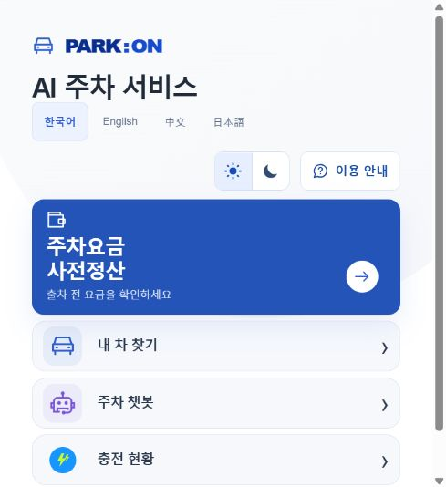
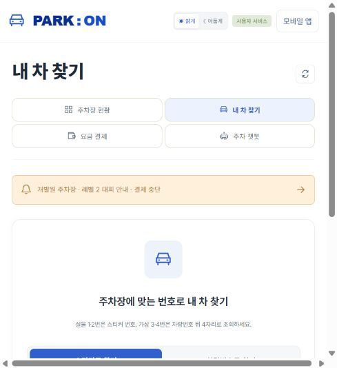
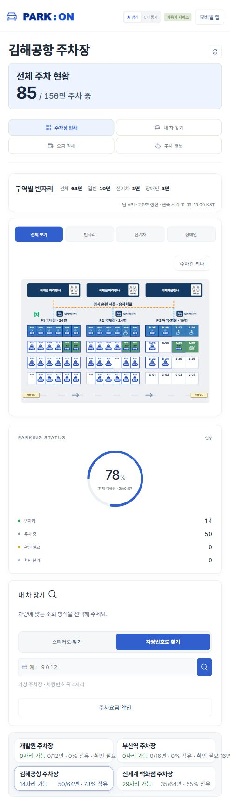
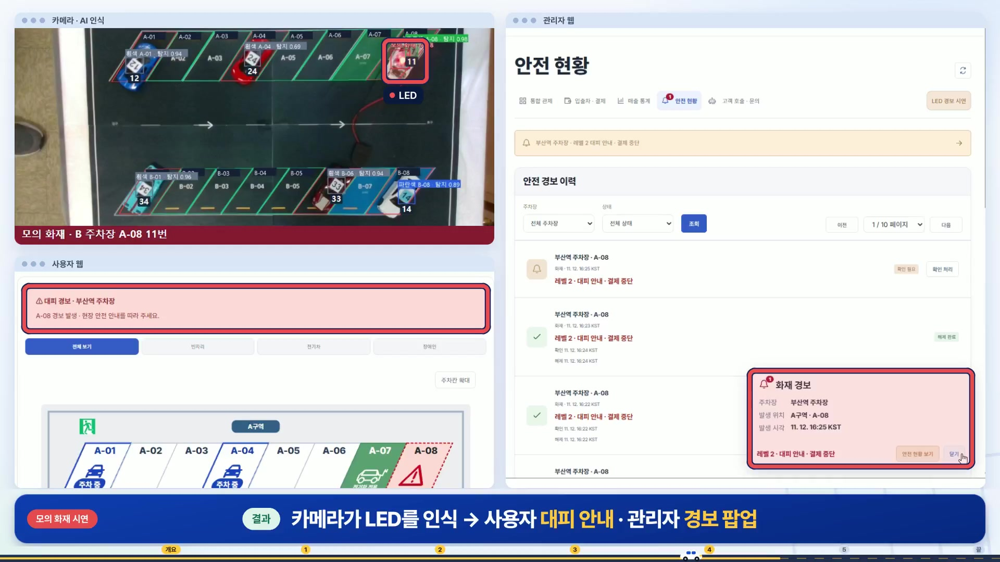
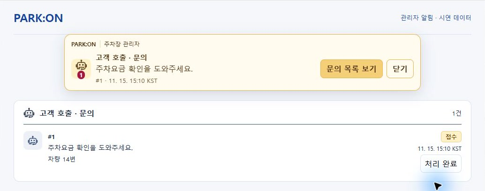

# PARK:ON · AI 스마트 주차장 통합관제

실물 주차장 2곳과 가상 주차장 2곳, 총 156면의 점유 상태와 차량 위치·요금·안전 경보를 한 화면에서 확인하는 6인 팀 프로젝트입니다. 김채린은 사용자 웹·모바일과 관리자 관제 화면을 맡고, 시연 환경의 API·배포 통합과 챗봇 UI 개선을 진행했습니다.

카메라와 AI가 차량 상태를 관측하면 서버가 주차면 점유와 입출차 세션을 확정합니다. 사용자 화면과 관리자 관제는 같은 API의 응답을 표시합니다.

[운영 사이트](https://parkon.duckdns.org/) · [팀 프로젝트 소스와 실행 안내](https://github.com/intel7-smart-parking-ai/smart-parking-ai)

## 운영 화면

2026년 11월 15일 공개 사이트에서 캡처했습니다. 빈자리와 경보 표시는 캡처 당시 상태입니다.

| 시작 화면 | 내 차 찾기 |
| --- | --- |
|  |  |

김해공항 주차장 지도 보기

### 관리자 알림

**화재 경보** · 최종 발표 영상에서 캡처했습니다. 모형 주차장의 LED를 카메라가 인식하면 사용자에게 대피 안내가 뜨고, 관리자 화면 오른쪽 아래에 발생 위치와 결제 중단 상태가 표시됩니다.

**고객 호출** · 팀 프로젝트의 관리자 알림 UI에 시연용 문의를 넣어 재현했습니다. 새 문의와 미처리 건수가 팝업에 표시되고, 관리자는 문의 목록으로 이동할 수 있습니다.

## 기능 시연

2026년 11월 13일 최종 발표 시연 영상에서 **카메라 차량 인식 → 주차 지도 반영 → 요금 조회·모의 결제** 구간을 약 46초로 발췌했습니다. [MP4 시연 영상 열기](parkon-demo.mp4)

**챗봇 사용** · 최종 발표 시연 영상에서 모바일 챗봇에 차량 위치와 주차요금을 묻고 전기차 충전 구역 빈자리를 확인하는 구간을 약 41초로 발췌했습니다. [챗봇 시연 MP4 열기](parkon-chatbot.mp4)

## 내 기여

| 담당 영역 | 구현 내용 | 병합 PR |
| --- | --- | --- |
| 사용자 웹·모바일 | 빈자리·전용칸을 표시하는 주차 지도, 차량 위치·이용 시간·요금 조회, 무료 회차 안내, 모의 결제·영수증 화면을 구현했습니다. | [#52](https://github.com/intel7-smart-parking-ai/smart-parking-ai/pull/52) · [#138](https://github.com/intel7-smart-parking-ai/smart-parking-ai/pull/138) · [#150](https://github.com/intel7-smart-parking-ai/smart-parking-ai/pull/150) |
| 관리자 통합관제 | 현재 입차와 출차 이력, 고객 호출, 월별 매출·안전 현황을 표시했습니다. 확인이 필요한 주차면을 빈자리와 구분하고 대피 경보 중 결제를 차단했습니다. | [#52](https://github.com/intel7-smart-parking-ai/smart-parking-ai/pull/52) · [#100](https://github.com/intel7-smart-parking-ai/smart-parking-ai/pull/100) · [#126](https://github.com/intel7-smart-parking-ai/smart-parking-ai/pull/126) |
| API·배포 통합 | 기존 점유 엔진에 세션·요금·경보 API를 연결하고, SQLite 이벤트 복구와 Docker Compose 기반 웹·API·관리자 인증 구성을 추가했습니다. | [#53](https://github.com/intel7-smart-parking-ai/smart-parking-ai/pull/53) · [#54](https://github.com/intel7-smart-parking-ai/smart-parking-ai/pull/54) |
| 다국어 챗봇 UI | 웹·모바일 채팅 화면을 정리하고 한국어·영어·중국어·일본어 응답 표시, 음성 입력 자동 전송, iPhone Safari 기기 음성 선택을 적용했습니다. | [#74](https://github.com/intel7-smart-parking-ai/smart-parking-ai/pull/74) · [#144](https://github.com/intel7-smart-parking-ai/smart-parking-ai/pull/144) · [#152](https://github.com/intel7-smart-parking-ai/smart-parking-ai/pull/152) |

- **기술 스택** · React, Vite, FastAPI, SQLite, Docker Compose, Nginx
- **검증** · 통합 시연 환경에서 입차 → 요금 조회 → 모의 결제 → 출차와 경보 중 결제 차단, API 재시작 후 상태 보존을 확인했습니다. Docker 통합 PR에는 백엔드 테스트 350개, iPhone 음성 개선 PR에는 프론트엔드 테스트 90개 통과를 기록했습니다. [#54](https://github.com/intel7-smart-parking-ai/smart-parking-ai/pull/54) · [#152](https://github.com/intel7-smart-parking-ai/smart-parking-ai/pull/152)
- **공동 담당** · 차량 번호 스티커 인식 AI는 팀원과 공동 담당했습니다. [팀 역할 분담](https://github.com/intel7-smart-parking-ai/smart-parking-ai/blob/main/README.md#3-팀-구성-및-담당-업무)
